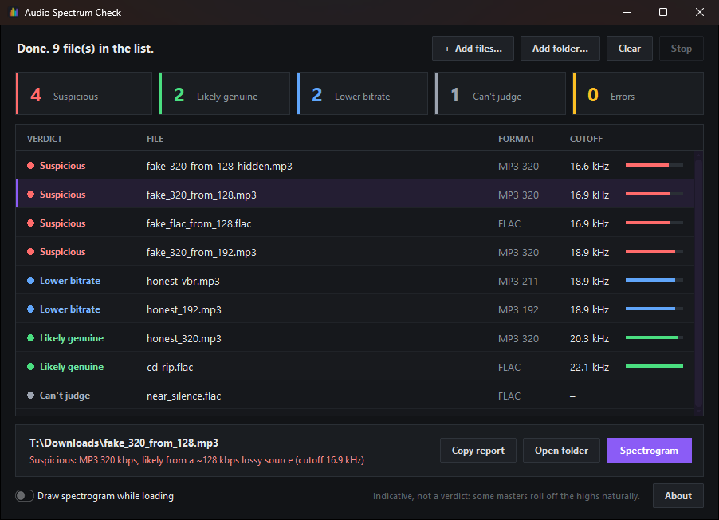
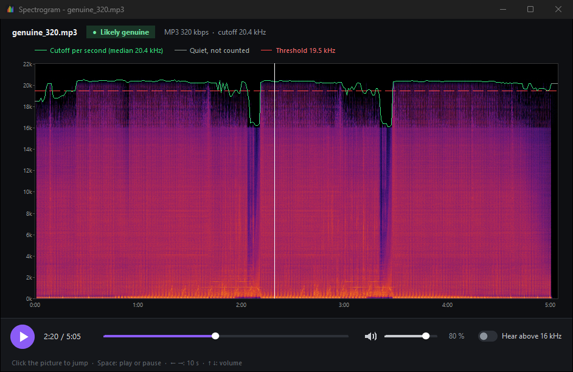
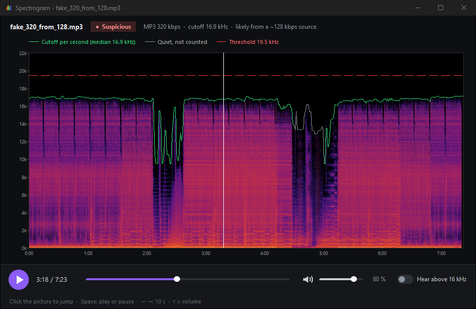

# Audio Spectrum Check

**Is that 320 kbps MP3 really 320? Check any downloaded track in seconds, and take a
closer look when something seems off.**

Music downloaded from the internet is not always what it claims to be. A file says
"320 kbps", but it was blown up from a 128 kbps copy. A "lossless" FLAC turns out to
be a converted MP3. Every player shows the declared quality, on headphones it sounds
fine, and you only notice on a big system, in the middle of a set, or never.

Audio Spectrum Check is a free Windows tool that reads the truth from the audio itself:
from its spectrum. It started as a quick fake detector and grew into a full quality
inspection of a track.

## Check many files at once

Select files or whole folders in Explorer, right-click and choose
**Audio Spectrum Check**, or drag them into the window. Every MP3, FLAC and OGG gets
a verdict:

| Verdict | What it means |
|---|---|
| **Likely genuine** | The spectrum reaches as high as the format and bitrate promise. |
| **Suspicious** | It ends far too low: most likely made from a lower-quality source. The tool also estimates which one, e.g. "likely from a ~128 kbps source". |
| **Lower bitrate** | A genuine file at a bitrate below 320 kbps, e.g. MP3 192 or OGG 192. Not a fake. How it sounds depends on the codec: MP3 192 loses some detail, while OGG from 192 kbps keeps the whole frequency range and sounds close to MP3 320. |
| **Can't judge** | Silence, or too quiet to measure. |
| **Error** | The file could not be read. |

Also caught: fakes that hide their missing top under a layer of faint noise. The
tool finds the sharp codec "wall" underneath.

For recorded mixes (DJ sets, live recordings over 30 minutes) it also marks the
parts that were played from a worse source, e.g. "51:50-56:00", so you know which
track in the set was the bad one.

One window collects everything: new files from Explorer go into it, several files
are checked at the same time at low priority, so you can keep working.
"Copy report" puts the full results on the clipboard.

## Take a closer look at one file

Double-click a row to open its spectrogram, the kind of picture you may know from
Spek, with the analysis drawn over it:

- the measured cutoff as a curve, second by second, so you see exactly where the
  track loses its top;
- the threshold this file had to reach for its format and bitrate;
- quiet parts that did not count for the verdict, drawn grey;
- in a mix, the suspicious parts marked red.

Then listen to what you see. Click anywhere on the picture and it plays from there.
**Hear above 16 kHz** plays only the very top of the track, shifted down so you can
actually hear it: a genuine track hisses and sparkles there, a fake from 128 kbps
leaves a thin band or silence.

Right-click a track to play it in your usual player or open it with another program.

*A genuine 320 kbps MP3: the cutoff runs near 20 kHz and dips only in the breaks,
where there is little high-frequency sound.*

*A "320 kbps" MP3 made from a 128 kbps copy: the cutoff stays around 17 kHz, far
below the 19.5 kHz threshold.*

## How it works

A lossy encoder throws away everything above a certain frequency: about 17 kHz at
128 kbps, about 20 kHz at 320 kbps. Converting the file to a higher bitrate or to
FLAC cannot bring that back, so the spectrum still ends in a sharp wall far below
where it should. Audio Spectrum Check measures where the spectrum really ends,
every 10 seconds through the whole file, and compares that with what the format
and bitrate promise. MP3 and OGG are each checked against the cutoffs their own
encoder leaves at every bitrate: OGG Vorbis keeps much more of the top than MP3,
and from 192 kbps up it keeps all of it.

## Download and install

1. Download `AudioSpectrumCheck-Setup.exe` from the **[latest release](../../releases/latest)**.
2. Run it and allow administrator rights. Nothing else is needed: no Python,
   no ffmpeg, everything is inside.
3. On Windows 11 the Explorer command is under *Show more options*
   (or hold Shift while right-clicking). The program is also in the Start menu.

To update, close the program and run the new installer over the old version.
Uninstall from Windows "Apps & features".

## Limits

The method is not 100% accurate. Some old recordings and some masters roll off the
top on purpose, so treat *Suspicious* as a reason to look and listen closer, not as
a final verdict. It also cannot expose a fake made from a high-quality lossy source
(LAME V0, 256 kbps): its spectrum is practically the same as the real thing.

---

This repository only hosts the ready-made installer. The source code is in a
separate private repository.
